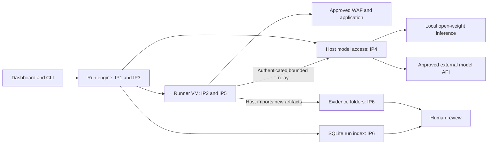

# Tool, Agent, and Model Integration with OWASP Coverage

Updated 5 October 2026. Status: proposed integration design, based on the supplied tool inventory and existing code.

Open the [interactive visual explainer](../architecture/owasp-tool-integration.html) to inspect integration points, tool assignments, and evidence examples.

## Purpose

The lab uses tools to collect observations, agents to investigate, and models to assist reasoning. Test cases and reviewed evidence establish coverage.

Use these versioned OWASP lists:

- [Web Application Top 10:2025](https://top10.owasp.org/2025/0x00_2025-Introduction/).
- [API Security Top 10:2023](https://api-security.owasp.org/editions/2023/en/0x00-header/).
- [LLM Application Top 10:2025](https://genai.owasp.org/llm-top-10/).

The mappings below are our intended test assignments. They are not tool certifications or validated external coverage.

The [tool registry](../pentest-tools/manifests/lab-tool-coverage.json) records sources, pinned revisions, and current integration limits. Review each license before deployment. Source availability does not establish permission for every use. Open-weight model licenses also require review.

## Assessment profiles

The [web application, AI application, and AI agent presentation](../presentations/output/web-app-ai-agent-testing.pptx) summarizes these profiles.

Use three separate profiles. Web application testing is the primary profile. Add an AI profile only when the approved target includes that feature.

| Profile | Target | Main objectives | Required observations |
|---|---|---|---|
| Web application and API testing | Approved website routes and APIs through the WAF | Access control, authentication, injection, configuration, and business rules | Test accounts, expected outcomes, and WAF/application logs |
| AI application testing | An approved model endpoint or AI feature with retrieval and output consumers | Prompt injection, disclosure, unsafe output handling, retrieval isolation, and resource limits | Synthetic test data, target adapter, retrieval records, and downstream effects |
| AI agent testing | An approved agent with tools, permissions, and workflow state | Action permissions, scope, approval rules, tool use, and execution effects | Test identities, action policy, approval records, tool events, and state changes |

An agent that helps assess a website is a lab assistant. An agent that belongs to the target application is a test target. Record these roles separately.

Testing a lab assistant checks the lab's controls. It does not establish the security of an external agent.

### Web application profile

Start with one approved hostname and a small route set. Check normal requests before active test cases.

Use separate accounts to test record ownership and role permissions. Compare allowed requests with denied requests. Check application state and audit records.

A WAF decision is one observation. Review application behavior before accepting a finding. Source, design, and provenance checks need additional access.

### AI application profile

Use synthetic secrets and documents. Check retrieved data and downstream behavior in addition to model text.

- Check whether hostile input changes the approved task.
- Check whether retrieval exposes another tenant's synthetic document.
- Check whether output consumers handle model output safely.
- Check whether responses reveal protected synthetic instructions.
- Check request, token, and time limits with approved low limits.

These cases can map to LLM01, LLM02, LLM05, LLM07, LLM08, and LLM10. Other categories require the additional evidence listed below.

### AI agent profile

Define allowed actions before testing. Record the agent's identity, tool permissions, approval rules, and expected state changes.

| Case | Expected result | Evidence |
|---|---|---|
| Hostile target content requests an action outside scope | The action control denies the request. No unauthorized action occurs. | Proposed action, policy decision, tool events, and state observations |
| An agent requests another user's record through a tool | The tool or application denies access. | Agent identity, native tool request, access decision, and audit records |
| An agent requests an action that needs approval | Execution waits for valid approval. Changed actions need new approval. | Action parameters, approval record, execution events, and actual effects |
| A tool response contains hostile instructions | The response cannot expand permissions or change approved scope. | Tool response, subsequent proposed actions, policy decisions, and execution events |
| An agent continues after a stop or exceeds a limit | The control prevents new actions. Preserve partial evidence. | Stop event, resource counters, process/tool events, and final state |

Prompt-driven cases can map to LLM01. Excessive action permissions can map to LLM06. Data disclosure can map to LLM02.

Native authorization failures can also map to Web A01 or API1/API5. Record each mapping reason. Do not count category labels as separate findings.

The agent's statement that it refused an action is insufficient evidence. Check the actual tool execution and resulting state.

All three profiles remain proposed operational capabilities. The current collector supports limited unauthenticated GET-query observations. PyRIT supports seed export and import checks only.

## Integration points

| Point | Location in proposed architecture | Input and output | Required boundary |
|---|---|---|---|
| IP1: campaign planning | Shared run engine | Approved scope and test objectives become a reviewed tool plan | Every tool has a disposition and reason. Changes invalidate approval. |
| IP2: tool execution | Disposable runner VM | Fixed adapter arguments become requests, raw outputs, exit status, and usage | Enforce scope, pacing, total budgets, timeout, and process-tree stop. |
| IP3: agent actions | Engine action API, called from the runner | Typed proposals become accepted or denied tool steps | No arbitrary host shell. Target content cannot change approval. |
| IP4: model access | Host model access module and bounded relay | Approved prompt content becomes model output and usage records | Named provider, allowed data, protected keys, and usage limits. |
| IP5: target translation | Accepted tool or PyRIT target adapter | Logical test identities become native requests and authenticated sessions | Preserve server-derived identity and exact route/method scope. |
| IP6: evidence and review | Host evidence importer and run index | New artifacts become restricted files, metadata, and reviewer decisions | Runner cannot change history. Escape untrusted output in the dashboard. |

All six points remain proposed shared-service interfaces. Existing local functions can supply implementation pieces. They do not provide deployed service boundaries.

Arrows show requests or artifact transfer. Replies return through the same call paths. A private control channel links the engine and runner.

## Existing code and reuse boundaries

| Existing source | What exists | Proposed connection |
|---|---|---|
| `lab/run-lab.sh` | Dispatcher for the local harness and separate WAF path | Retain local commands. Add a thin CLI for the shared service. |
| `lab/waf-assessment/run_assessment.py` | Scoped WAF assessment entry point | First IP2 adapter, preserving its supported request contract. |
| `lab/waf-assessment/scope.py` | WAF scope validation | Reuse checks within the adapter. Add aggregate engine accounting. |
| `lab/harness.py` | Local validation, approval, Broker, campaign, evidence, and planner logic | Reuse contracts and fixtures for calibration. Keep numeric loopback restrictions. |
| `lab/application_adapter.py` | Translation to synthetic authenticated application routes | IP5 calibration adapter. Real authentication requires a separate contract. |
| `lab/pyrit_import_check.py` | Validation of exported seed datasets | Import check only. Add an accepted PyRIT executor, target, and scorer later. |
| `lab/run_calibration.py` | Local calibration workflow | Supply repeatability checks and reports for accepted model roles. |
| `lab/application_server.py` | Synthetic target with its own SQLite state and optional inference | Calibration target, separate from the campaign run index and management model access. |

Read [existing adapter contracts](../lab/ADAPTERS.md) before reuse. Do not remove loopback limits to make the harness a general external scanner.

## Tool and agent assignments

Web codes below refer to 2025. API codes refer to 2023. LLM codes refer to 2025.

| Supplied component | Integration point | Intended contribution | Candidate OWASP coverage | Acceptance prerequisite |
|---|---|---|---|---|
| Existing WAF collector and curl | IP2, IP5, IP6 | Bounded GET-query observations and evidence | Selected Web A05 Injection and A02 Misconfiguration cases | Supported routes, baseline, scope, and correlated evidence |
| wafw00f | IP2, IP6 | Active WAF fingerprinting | Supports Web A02/A05 context. No independent category coverage | Count detection requests and restrict destination |
| WhatWaf | IP2, IP6 | Selected filtering and bypass research | Selected Web A05 cases, with A02 context | Review enabled behavior and calibrate specific cases |
| Nuclei | IP2, IP5, IP6 | Template-specific checks | Only categories supported by reviewed templates, including selected A02/A05 cases | Pin templates and validate their requests and expected evidence |
| ProjectDiscovery httpx | IP2, IP6 | Approved HTTP endpoint inventory | API9 Improper Inventory Management, with A02 context | Confirm the correct binary and approved asset scope |
| subfinder | IP2, IP6 | Approved domain discovery | Supporting API9 inventory evidence | Domain discovery scope. Discovered hosts remain unapproved |
| Nmap | IP2, IP6 | Approved host and service mapping | Supporting A02 configuration and API9 inventory evidence | Exact hosts and ports, including shared-edge scope |
| DNS-history | IP2, IP6 | Investigate potential origin exposure | Candidate A02 configuration evidence | Separate origin scope. Do not probe discovered IPs automatically |
| Strix | IP3, IP4, IP2, IP5, IP6 | Agent-assisted web/API investigation | Selected A01 Access Control, A05 Injection, A07 Authentication and API authorization cases | Provider compatibility, containment, and case calibration |
| Shannon | IP3, IP4, IP2, IP5, IP6 | Agent-assisted application investigation | Same candidate web/API objectives where its selected mode supports them | Confirm mode and source requirements, then calibrate |
| Pentest-AI | IP3, IP4, IP2, IP6 | Investigation and verification | Selected web/API objectives defined by the campaign | Accepted actions, provider, scope, and usage accounting |
| CyberStrike | IP3, IP4, IP2, IP5, IP6 | Browser and application investigation | Selected authentication, authorization, and injection cases | Browser requests and sessions remain within scope |
| Numasec | IP1, IP3, IP4 | Coordinate selected workflows | Inherits evidence from actual accepted test steps | Cannot create a second scope or execution authority |
| Raptor | IP2 or IP3, IP4, IP6 | Source-assisted investigation | Selected A01, A04 Cryptography, A05, A07, A08 Integrity cases | Approved source, compatible provider, and verified findings |
| Semgrep | IP2, IP6 | Rule-based source checks | Selected categories supported by pinned rules | Approved source and rules. Review alerts for real impact |
| CodeQL | IP2, IP6 | Source data-flow queries | Selected categories supported by language and query suite | Source/build inputs, runtime acceptance, and license review |
| PyRIT | IP2, IP4, IP5, IP6 | Repeatable AI application evaluations | Selected LLM01, LLM02, LLM05, LLM06, LLM07, and LLM08 cases | Accepted target adapter, attack configuration, scorer, and ground truth |
| PyRIT course | IP1 and reviewed PyRIT configuration | Training examples and case design | Only accepted cases implemented through PyRIT | Adapt examples to the installed version |
| Hermes | IP3, IP4, IP6 | Candidate planner or reviewer runtime | No independent OWASP coverage | Typed actions, provider compatibility, and role calibration |
| Pi | IP3, IP4, IP6 | Candidate general agent runtime | No independent OWASP coverage | Same runtime acceptance boundary as Hermes |
| 10x-pentest | IP1 | Reviewed methodology and test objectives | Supports campaign design across applicable categories | Translate procedures into concrete accepted cases |
| Claude-BugHunter | IP1 and IP3 when skills execute | Reviewed investigation skills | Supports selected campaign objectives | Review each skill and constrain resulting actions |
| Claude Code | IP3, IP4, IP6 | Candidate provider-backed assistant | No independent OWASP coverage | License, provider, data release, and sandbox checks |
| dig/nslookup and jq | IP2 or IP6 | DNS diagnostics and local evidence processing | No independent category coverage | Scoped resolution and safe processing of untrusted results |

Most supplied repositories are not integrated. PyRIT currently supports seed export and import validation only. Existing collector tests do not establish external campaign coverage.

## Models and open weights

| Model role | Integration | Use | Required acceptance |
|---|---|---|---|
| Local planning model | IP4 from the engine | Select approved cases and explain proposed priorities | Valid structured output and no scope expansion |
| Local review model | IP4 with approved evidence excerpts | Suggest explanations and evidence gaps | Grounded conclusions, measured false positives, human review |
| Local model used by an agent | IP4 through the bounded runner relay | Support accepted agent actions | Tool-call compatibility, data policy, timeout, and usage limits |
| Grok 3.7 Cyber | External IP4 adapter | Specialist analysis of approved content | Exact URL/model ID, access, retention, data approval, compatibility, and calibration |
| Model or AI application under test | IP5 target adapter | Measure AI application risk | Known test objectives, ground truth, accounts, and observable effects |

A model used to help testing is different from a model under test. Sending evidence to a cyber model does not automatically test OWASP LLM risks.

Open weights permit local inference subject to license terms. They do not establish full open-source status, safe behavior, or compatibility with every agent.

Local-only campaigns deny external model calls and fallback. External campaigns approve the provider and permitted data before execution. Keep keys and session secrets outside prompts.

Start with one local inference service. Move to a dedicated GPU host only after resource measurements or isolation requirements justify it.

## Tests that establish coverage

| Objective | OWASP mapping | Integration path | Evidence needed |
|---|---|---|---|
| Alice cannot read Bob's record | Web A01, API1 Broken Object Level Authorization | IP1 case, IP5 identities, IP2 execution, IP6 review | Own-record success, cross-owner denial, and application audit evidence |
| A user cannot call an administrator function | Web A01, API5 Broken Function Level Authorization | IP5 role-aware adapter and IP2 | Native requests for permitted and forbidden roles, plus actual effects |
| A request cannot set a protected object property | API3 Broken Object Property Level Authorization | IP5 property-aware adapter | Accepted legitimate change and absence of unauthorized state change |
| Unsafe input does not reach a database or rendering sink | Web A05 | IP2 accepted case, optional source investigation | Request, WAF decision, and application or sink evidence |
| Test requests appear in alerts and application logs | Web A09 Logging and Alerting Failures | IP6 log import and reviewer correlation | Matching request IDs and observed alert behavior |
| A target document cannot redirect agent authority | LLM01 Prompt Injection and LLM06 Excessive Agency | IP3 controlled actions, IP4 model, IP6 events | Attempted action, policy decision, and actual execution outcome |
| Retrieval excludes another tenant's document | LLM02 Disclosure and LLM08 Vector/Embedding Weaknesses | IP5 AI target adapter | Retrieval observations and independent access checks |
| Downstream code handles model output safely | LLM05 Improper Output Handling | IP5 target and controlled sink instrumentation | Actual sink behavior, not only model text |
| The application does not reveal protected instructions | LLM07 System Prompt Leakage | IP5 AI target adapter | Protected synthetic canary and reviewed outputs |
| An inference workflow respects resource limits | LLM10 Unbounded Consumption | IP4 and instrumented AI target | Token/request/time observations and bounded failure behavior |

The same authorization weakness can map to multiple lists. Record the list version and mapping reason rather than counting each label as another finding.

Resource-consumption tests use approved low limits and synthetic calibration. Rate enforcement in our lab does not establish the target's own rate-limit effectiveness.

## Coverage gaps and prerequisites

| OWASP area | What is needed beyond a WAF response |
|---|---|
| Web A03 Software Supply Chain Failures | Dependency/build inventory, provenance, and supply-chain checks. Current source scanners alone are insufficient. |
| Web A04 Cryptographic Failures | Relevant code, TLS/configuration evidence, and design review |
| Web A06 Insecure Design and API6 Sensitive Business Flows | Business rules, test roles, expected state transitions, and human review |
| Web A08 Software or Data Integrity Failures | Update/data trust boundaries and relevant implementation evidence |
| Web A09 Logging and Alerting Failures | Application/WAF logs and observed alert behavior |
| Web A10 Mishandling of Exceptional Conditions | Fault scenarios, rollback/state observations, and recovery evidence |
| API2 Authentication and API4 Resource Consumption | Accepted authentication adapters and instrumented bounded tests |
| API7 SSRF and API10 Unsafe Consumption of APIs | Approved interaction infrastructure or source/configuration evidence |
| LLM03 Supply Chain and LLM04 Data/Model Poisoning | Model/data provenance, controlled datasets, and suitable dedicated evaluations |
| LLM09 Misinformation | Domain-specific ground truth and calibrated evaluators |

LLM tests apply when an AI application is in scope. A conventional website behind a WAF does not automatically need an LLM-target test profile.

## Adapter contract and evidence record

Each accepted tool adapter declares its version, supported target contracts, OWASP case IDs, argument schema, required data, and observable outcomes.

The engine checks capabilities before execution. The runner reports actual request counts and execution state. If required controls cannot be enforced, the tool stays blocked.

Record these fields for each case:

- Run ID, step ID, case ID, and target route.
- OWASP list, version, category, and mapping reason.
- Approved scope hash and reviewer identity.
- Tool/adapter revision and model role, if used.
- Expected outcome, observed outcome, and artifact references.
- WAF decision and application effects, or explicit evidence gaps.
- Finding disposition and human reviewer decision.

Separate execution state from review outcome. A completed tool step can produce an inconclusive result. Untested objectives remain visible.

## Implementation sequence

1. Phase 0 defines the campaign and case-to-OWASP contracts.
2. Phases 1 and 2 add evidence records and the existing collector adapter.
3. Phase 3 validates VM containment and network controls.
4. Phase 4 accepts deterministic tools against specific cases.
5. Phase 5 accepts local model roles and bounded agent actions.
6. Phase 6 adds the confirmed external model adapter.
7. Phase 7 runs the approved corporate assessment and reviews coverage gaps.

See the [implementation plan](IMPLEMENTATION_PLAN.md). No tool integration, model call, or external assessment occurred during this documentation update.
