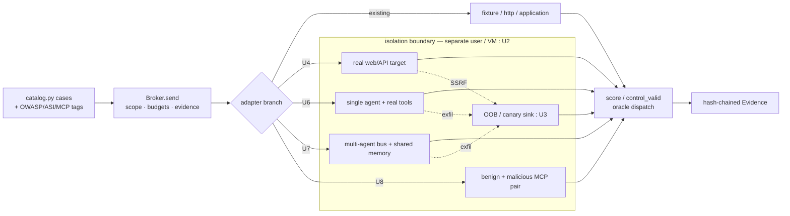

# feat: Consolidated pentest methodology and lab capability roadmap

**Created:** 2026-10-10
**Type:** feat
**Depth:** Deep
**Target repo:** this repo (AI Security Lab)
**Scope:** a tool-agnostic pentest methodology for five target classes — web/API apps, AI apps, AI agents, agentic AI, MCP servers — plus a staged roadmap that makes this lab able to exercise and verify each class.

---

## Summary

The lab today is a single-process campaign harness (`lab/harness.py`) plus an authenticated SQLite-backed test range (`lab/application_server.py`). It runs control-then-attack-twice campaigns through one chokepoint (`Broker.send`), scores observable effects, and saves tamper-evident evidence. It covers a narrow web/API benchmark well and models AI-app behavior with mocked, self-reported effects. AI agents, agentic AI, and MCP servers are absent.

This plan does two things. First, it records a tool-agnostic methodology per class anchored to current (2026) standards. Second, it lays a dependency-ordered roadmap that extends the existing harness seams — not a rewrite — so each class becomes a real, verifiable target. The load-bearing rule throughout: a finding is proven by an observable effect (a log entry, a state change, an out-of-band callback), never by what a model or target says it did.

---

## Problem Frame

A pentest lab is only useful if it can (1) exercise a target class with realistic attacks and (2) prove each finding reproduces. The current lab meets both bars for a small web/API set, but its AI coverage trusts the target's self-reported `trace` object, which `ADAPTERS.md:50` states a custom target can falsify. The three newest and highest-demand classes — single tool-calling agents, multi-agent systems, and MCP servers — have no target, no cases, and no oracles. The methodology for all five is scattered across proposal docs rather than consolidated against named 2026 frameworks.

---

## Current-State Review (clean review of the app)

### Capability map

- **Harness** (`lab/harness.py`): `catalog/validate/approve/run/assist/export-pyrit/verify`. A campaign sends a benign control, then the attack twice (first + independent replay) through `Broker.send` (`lab/harness.py:149`). A case is `reproduced_failure` only when first and replay agree (`harness.score`, `lab/harness.py:234`).
- **Guardrails**: schema validation, numeric-loopback-only HTTP, SHA-256 approval binding, per-campaign request/time budgets, STOP file, redirect/5xx/429 denial, bounded response bytes.
- **Range** (`lab/application_server.py`): SQLite-backed HTTP process, `fixed`/`vulnerable` profiles, bearer sessions, `audit.jsonl`; `/api/ai/chat` can call a real local model with synthetic RAG and **mock** tool/sink effects.
- **Ground truth** (`lab/run_pilot.py`): reads SQLite + audit out-of-band to confirm effects independently of harness scoring.
- **Evidence** (`Evidence`/`verify`, `lab/harness.py:113`/`:364`): hash-chained `events.jsonl` + `sha256.json`, symlink- and `..`-rejecting.

### Coverage vs the five classes

| Class | Status | Evidence |
|---|---|---|
| Web/API apps | COVERED (narrow) | 4 cases (IDOR/BOLA, admin-export BFLA, payment, fail-closed dep) with SQLite/audit verification; no app-layer injection/XSS/SSRF |
| AI apps (LLM) | PARTIAL | 8 cases, optional real local model; calibration never executed; scoring trusts target `trace` |
| AI agents (single + tools) | PARTIAL (mocked) | tool use is `trace` fields in `application_server.py:94`; no real tool executes |
| Agentic AI (multi-agent) | ABSENT | only the `assist` planner picks catalog IDs; no orchestration, no containment |
| MCP servers | ABSENT | appears only in proposal glossary and a `ptai setup --mcp` note |

### Security of the lab's own code

Defensively strong and loopback-confined: strict central SSRF guard (`harness.endpoint()`, `lab/harness.py:58`), no `shell=True`/`eval`/`pickle`/`yaml.load`, fully parameterized SQL, constant-time session compare with 0600/0700 perms, 127.0.0.1-only binds, hash-chained evidence. Gaps live in the installer / collector / isolation layers, folded into U1-U2 below:

- **[P2]** `pentest-tools/install-browsers.py:15` — Playwright/ffmpeg archives downloaded without comparing sha256 to a pinned value (unlike node/httpx).
- **[P3]** `lab/waf-assessment/waf_check.py:50` + `scope.py:73` — WAF collector accepts any host with no metadata/RFC1918 denylist; gated only by an operator-authored scope.
- **[P3]** `lab/harness.py:381` — `verify()` proves hash-chain consistency only; runner and targets run as the same user with no OS boundary.
- **[P3]** `lab/application_server.py:33` — `audit.jsonl`/`model-events.jsonl` appends do not refuse a pre-planted symlink (the harness `write()` does).

---

## Success Criteria

- **SC1** — Each of the five classes has a documented methodology: attack surface, top techniques, tool-agnostic tooling, and a verification rule.
- **SC2** — Each class has at least one real (non-mocked) target the harness can drive through `Broker.send`.
- **SC3** — Every finding is verified by an observable effect (log, state diff, or OOB callback), not by target-reported `trace`.
- **SC4** — Nondeterministic AI findings report an N-run hit rate, not a single pass.
- **SC5** — Real tool execution, agentic orchestration, MCP targets, and outward web probing run inside an OS isolation boundary as a separate user.
- **SC6** — Cases are tagged to 2026 frameworks (OWASP Top 10:2025, API Top 10:2023, LLM Top 10 2025, Agentic ASI01-10, MCP spec 2025-11-25).

---

## Methodology per class

The arc is identical across classes: map surface → execute against trust boundaries → prove impact with an observable oracle → report. What changes is the surface and the oracle.

### Web / API apps
- **Surface:** HTTP/REST/GraphQL endpoints, auth/session flows, file uploads, webhooks, dependency + CI/CD supply chain. Boundaries: unauth→auth, user→user (tenancy), app→data store, app→internal network.
- **Techniques:** broken access control / IDOR / BOLA / BFLA (the #1 risk); injection (SQL, command, SSTI, GraphQL); SSRF; auth/session flaws; misconfiguration + exposed secrets; supply-chain (A03:2025); mass assignment; business-logic abuse.
- **Tooling (categories):** intercepting proxy (Burp/ZAP/mitmproxy), template scanner (nuclei), injection frameworks (sqlmap/commix), content discovery (ffuf/katana), SCA + secret scanners (trivy/gitleaks).
- **Verify:** account A mutating B's object (IDs + before/after state); injection via OOB oracle or extracted canary; SSRF via internal canary hit.

### AI apps (LLM-backed, RAG)
- **Surface:** prompt interface, system prompt, RAG corpus + vector store, tool/function-calling, downstream sinks. Shift: retrieved data is executable instruction; model output is untrusted input to the next step.
- **Techniques (LLM Top 10 2025):** direct + indirect (RAG) prompt injection, system-prompt leakage, sensitive-info disclosure, improper output handling → XSS/SSRF/SQLi/RCE, excessive agency, data/model poisoning, multi-turn crescendo, unbounded consumption.
- **Tooling:** probe scanners (garak), adversarial orchestration (PyRIT/DeepTeam), eval harness (promptfoo), plus the web proxy/exploitation stack to fire insecure output at a real sink.
- **Verify:** payload overrides behavior reproducibly at pinned seed/temperature (exfil a seeded secret or fire a forbidden tool); carry LLM output through to a real sink and trigger it; re-run N times, report hit rate.

### AI agents (single + tools)
- **Surface:** the prompt→tool-call boundary, ingested content as injection channel, system prompt, per-tool scope, short-term memory.
- **Techniques:** indirect injection driving an unintended tool call (LLM01→LLM06), excessive-agency abuse (legit tool on an unintended target), tool-schema leakage, SSRF/file-read via a fetch tool, unsafe code-exec reaching the host, scope/target-selection abuse.
- **Tooling:** agent probe suites (garak/PyRIT/Giskard/promptfoo), RAG-poisoning corpora, an interception proxy on the tool channel.
- **Verify:** captured function-call log with attacker-controlled args + the resulting state change or OOB exfil. "The model said it would" is not a finding.

### Agentic AI (multi-agent / autonomous)
- **Surface:** inter-agent message bus, shared/long-term memory, orchestrator loop, delegated sub-agent scopes.
- **Techniques (OWASP ASI01-10):** inter-agent trust exploitation (an instruction refused from a human is obeyed from a "peer" agent), Agent-in-the-Middle message tampering, memory/context poisoning (ASI06), cascading failures (ASI08), rogue/collusive agents, planner goal hijack (ASI01).
- **Tooling:** harnesses that script full flows (user + tool + inter-agent messages), a message-bus interceptor/spoofer, memory-store fuzzers.
- **Verify:** captured spoofed inter-agent message + the downstream privileged action; poisoned memory persists and alters a later run; cascade traced across ≥2 agents.

### MCP servers
- **Surface:** transport (stdio / HTTP+SSE) + auth, tool/resource **descriptions and schemas** (loaded into context as trusted text on connect), the OAuth/token boundary, servers sharing one context.
- **Techniques:** tool poisoning / "line jumping" (hidden instructions in `tools/list` fire before any call), rug pull (approved tool mutates post-install), tool shadowing / cross-origin escalation, confused deputy, forbidden token passthrough / over-broad scopes, SSRF/command injection in tool impls.
- **Tooling:** MCP static scanner + runtime proxy (mcp-scan / CSA tool-poisoning model), MITM proxy on the transport.
- **Verify:** proxy capture of `tools/list` showing the poisoned description entered context + the resulting action; pinned-hash diff proving a rug pull; cross-user action from a confused deputy; a forwarded token reaching a downstream API.

---

## High-Level Technical Design

New classes plug into the existing chokepoint and oracle dispatch rather than adding parallel harnesses. The adapter branch (`lab/harness.py:170`) and oracle dispatch (`lab/harness.py:234`) are the two extension points; everything to the right of the isolation boundary runs as a separate user.

---

## Key Technical Decisions

- **KTD1 — Extend seams, don't rebuild.** New classes attach at `Broker.send`'s adapter branch and the `score`/`control_valid` dispatch, inheriting scope, budgets, pacing, and evidence. Rationale: one audited chokepoint; the capability audit confirmed these seams are built for it.
- **KTD2 — Oracles read observable effects only.** Verdicts come from provider/application logs, out-of-band SQLite/audit reads (`run_pilot` pattern), or an OOB sink — never the target's self-reported `trace` (falsifiable per `ADAPTERS.md:50`). Serves SC3.
- **KTD3 — Tool-agnostic executors.** Integrate garak / PyRIT / promptfoo / mcp-scan / Burp / nuclei as pluggable executors behind the export (`export-pyrit`) and adapter seams. No vendor lock; capability is a category, not a product.
- **KTD4 — Isolation before real execution.** Real tool exec, agentic orchestration, MCP targets, and outward web probing run as a separate user in a VM/container. Rationale: lab-security found runner and targets share a user; agentic/agent classes need containment to run real tools safely. Gates U6-U8.
- **KTD5 — One shared OOB/canary sink.** A single DNS/HTTP collector is the universal verification backbone across injection, SSRF, agent exfil, and MCP. Built once in U3.
- **KTD6 — Hit-rate verdicts for AI.** Keep the first+replay agreement rule; extend it to an N-run hit rate for nondeterministic model outputs. Serves SC4.

---

## Implementation Units

Grouped into phases. U-IDs are stable. Each feature-bearing unit lists test files and scenarios; new targets live under new `lab/targets/` and `lab/mcp/` packages to keep the harness core small.

### Phase A — Substrate and hardening

### U1. Harden the lab's own-code findings
- **Goal:** close the installer/collector/append gaps the security audit found so the lab is safe for real use.
- **Requirements:** SC5 (partial).
- **Dependencies:** none.
- **Files:** `pentest-tools/install-browsers.py`, `lab/waf-assessment/waf_check.py`, `lab/waf-assessment/scope.py`, `lab/application_server.py`, `lab/tests/test_hardening.py`.
- **Approach:** pin + compare sha256 for Playwright/ffmpeg archives (mirror `install-node-runtime.py:14`); add a metadata/RFC1918/loopback denylist to the WAF collector host check (mirror `harness.endpoint()`); refuse symlinks on the `audit.jsonl`/`model-events.jsonl` appends (mirror `harness.write()` at `lab/harness.py:44`).
- **Patterns to follow:** `harness.endpoint()` denylist; `harness.write()` symlink refusal; `install-httpx.py` sha256 gate.
- **Test scenarios:** mutated browser archive with wrong hash is rejected; WAF scope targeting `169.254.169.254` or a `10.x` host is refused; a pre-planted symlink at the audit path is not followed; a correctly pinned archive still installs.
- **Verification:** the three denials fire; existing WAF and pilot runs still pass.

### U2. Isolation substrate
- **Goal:** run targets, real tools, and outward probing as a separate, contained user.
- **Requirements:** SC5.
- **Dependencies:** none (precedes U4, U6, U7, U8).
- **Files:** `lab/isolation/` (new), `lab/RUNBOOK.md`, `docs/OWASP_TOOL_INTEGRATION.md`.
- **Approach:** a container/VM profile that runs the target side of `Broker.send` under a non-privileged user with egress limited to the OOB sink and the declared scope; the harness core stays host-side. Document the boundary and its limits.
- **Patterns to follow:** the existing loopback-only posture; `scope.py` expiring approvals for any egress.
- **Test scenarios:** a target attempting to write `lab/runs/` outside its own area is blocked; egress to an undeclared host fails; a contained tool still reaches the OOB sink.
- **Verification:** `verify()` runs host-side over evidence the contained target cannot reach; a deliberate escape attempt fails.

### U3. Shared verification backbone (OOB sink + RAG corpus + transcript capture)
- **Goal:** one canary sink and the injectable/seeded infrastructure every AI class needs.
- **Requirements:** SC3, SC4.
- **Dependencies:** U2.
- **Files:** `lab/oob/` (new collector), `lab/corpus/` (new RAG corpus with seeded secret canaries), `lab/harness.py` (evidence extension for transcripts/tool-calls), `lab/tests/test_oob.py`.
- **Approach:** a loopback DNS/HTTP collector that records callbacks with a per-case canary token; an injectable RAG corpus with planted malicious documents and seeded secrets; extend `Evidence.log` to capture full transcripts, tool-call logs, and retrieval provenance.
- **Patterns to follow:** hash-chained `Evidence` (`lab/harness.py:113`); `fixtures.Fixture` for offline variants.
- **Test scenarios:** a callback with the right token is attributed to its case; an unseeded callback is ignored; a seeded secret appears in the corpus only, and its exfil is detected at the sink; the transcript is hash-chained and `verify()`-clean.
- **Verification:** an end-to-end injection test proves exfil at the sink with a chained-evidence record.

### Phase B — Deepen current classes

### U4. Real web/API target adapter + injection/authz/SSRF oracles
- **Goal:** move web/API from a 4-case benchmark to a real target with injection, authz, and SSRF coverage.
- **Requirements:** SC1, SC2, SC3 (web/API).
- **Dependencies:** U2, U3.
- **Files:** `lab/targets/web/` (new adapter, e.g. a deliberately vulnerable app with fixed/vulnerable profiles), `lab/catalog.py`, `lab/harness.py` (adapter branch), `lab/tests/test_web_target.py`.
- **Approach:** add a `web` adapter branch mapping catalog routes to the target; add SQLi/SSTI/SSRF/XSS and cross-tenant authz cases; oracles use the OOB sink (SSRF/injection) and before/after state (authz).
- **Patterns to follow:** `application_adapter.translate` (`lab/application_adapter.py:21`); `run_pilot.run_profile` out-of-band verification.
- **Test scenarios:** cross-tenant read returns B's seeded record (fixed profile refuses); SQLi extracts a canary row; SSRF hits the internal canary; each has a passing hardened-profile counterpart; `Covers` the mapped OWASP tags.
- **Verification:** vulnerable profile reproduces each finding twice; hardened profile is clean; effects confirmed out-of-band.

### U5. AI-app real-model calibration + log-derived oracles
- **Goal:** run the real local model and replace trust in `trace` with provider/application-log oracles; add direct + indirect prompt injection and insecure-output-to-sink.
- **Requirements:** SC1, SC3, SC4 (AI apps).
- **Dependencies:** U3.
- **Files:** `lab/run_calibration.py`, `lab/application_server.py`, `lab/catalog.py`, `lab/tests/test_ai_app.py`.
- **Approach:** execute the calibration runs that have never run; derive oracles from `model-events.jsonl` and application state, not `trace`; add indirect-injection cases sourced from the U3 corpus and an insecure-output case that fires an LLM-emitted payload at a real sink; report hit rate over N runs.
- **Patterns to follow:** `Application.infer` (`lab/application_server.py:36`); `run_pilot` ground-truth reads; `export-pyrit` seed handoff.
- **Test scenarios:** indirect injection in a retrieved doc exfils a seeded secret to the sink (hit rate reported); system-prompt leakage reproduces at pinned seed; an LLM-emitted `alert()`/callback fires at the sink; a benign task still succeeds (quality baseline); hardened profile blocks each.
- **Verification:** verdicts derive only from logs/state/sink; `manual_vs_ai_value` baseline recorded; N-run hit rate in the report.

### Phase C — New classes

### U6. Single tool-calling agent target
- **Goal:** a real agent with genuinely wired, contained tools and an oracle that proves actual tool invocation.
- **Requirements:** SC1, SC2, SC3 (AI agents).
- **Dependencies:** U2, U3.
- **Files:** `lab/targets/agent/` (new), `lab/catalog.py`, `lab/harness.py`, `lab/tests/test_agent_target.py`.
- **Approach:** an `agent` adapter running a single agent with real but contained tools (file, fetch, shell to a sandbox, a DB); an interception proxy logs every function call; oracles assert the captured call args + resulting state change or OOB exfil.
- **Patterns to follow:** the trace contract in `ADAPTERS.md` becomes a *captured* contract, not self-reported; `Broker.send` adapter branch.
- **Test scenarios:** indirect injection drives a forbidden tool call (captured in the proxy log); excessive-agency redirects a delete/email onto an attacker-chosen object; a fetch tool performs SSRF to the canary; the host is not reachable from the sandboxed shell; hardened profile denies each.
- **Verification:** each finding shows the function-call log + state/sink effect; no verdict relies on `trace`.

### U7. Agentic multi-agent substrate
- **Goal:** a multi-agent target with a tappable/injectable message bus, shared memory, and AiTM / memory-poisoning / authority-escalation oracles.
- **Requirements:** SC1, SC2, SC3 (agentic).
- **Dependencies:** U2, U3, U6.
- **Files:** `lab/targets/agentic/` (new bus + orchestrator + shared memory), `lab/catalog.py`, `lab/tests/test_agentic.py`.
- **Approach:** a typed capability broker and an inter-agent bus that the harness can tap and inject; oracles capture a spoofed peer message plus the downstream privileged action, prove poisoned memory persists into a later run, and detect "target content enlarges authority" (named in `ai-security-lab-proposal.md:122`).
- **Patterns to follow:** `assist` planner (`lab/harness.py:449`) becomes an executor behind the broker; U6 agent as a node.
- **Test scenarios:** an instruction refused from the user is obeyed when injected as a peer message (hit rate); AiTM alteration of a peer message changes the downstream action; poisoned shared memory alters a later run's tool calls; a cascade is traced across ≥2 agents; hardened profile isolates roles.
- **Verification:** captured injected message + downstream effect; persistence across runs demonstrated; cascade in the trace log.

### U8. MCP server target (benign + malicious pair)
- **Goal:** an MCP target exercising tool poisoning, rug pull, confused deputy, and token passthrough, with transcript proof.
- **Requirements:** SC1, SC2, SC3 (MCP).
- **Dependencies:** U2, U3.
- **Files:** `lab/mcp/` (new client adapter + benign and malicious server pair), `lab/catalog.py`, `lab/tests/test_mcp.py`, `docs/OWASP_TOOL_INTEGRATION.md`.
- **Approach:** an `mcp` adapter and a benign+malicious server pair with identical-looking tools; the malicious server carries poisoned `tools/list` descriptions and a rug-pull toggle; a transport proxy captures `tools/list` and calls; integrate an MCP scanner (mcp-scan) as a tool-agnostic executor.
- **Patterns to follow:** `application_adapter.translate` as the adapter template; `scope.py` expiring approval for any networked server.
- **Test scenarios:** a hidden instruction in a tool description triggers an action before any call (line jumping), captured in the proxy transcript; a pinned tool-hash diff proves a rug pull after approval; a confused-deputy call performs a cross-user action; a forwarded token reaches a downstream canary; the benign server produces none of these.
- **Verification:** proxy transcript shows the poisoned description entering context + the resulting action; hash diff recorded; all effects at observable boundaries.

### Phase D — Taxonomy and reporting

### U9. Framework tagging and report mapping
- **Goal:** tag every case to its 2026 framework and surface the mapping in reports.
- **Requirements:** SC6.
- **Dependencies:** U4, U5, U6, U7, U8.
- **Files:** `lab/catalog.py`, `lab/harness.py` (REPORT.md generation), `docs/OWASP_TOOL_INTEGRATION.md`.
- **Approach:** extend the case schema tags to OWASP Top 10:2025, API Top 10:2023, WSTG, LLM Top 10 2025, Agentic ASI01-10, and MCP spec sections; render a coverage-by-framework table in `REPORT.md` and `coverage.json`.
- **Patterns to follow:** `catalog.case` tag fields (`lab/catalog.py:7`); existing `coverage.json`.
- **Test scenarios:** every case carries at least one framework tag; the coverage table counts match the catalog; an untagged case fails validation.
- **Verification:** `harness validate` enforces tags; the report shows per-class, per-framework coverage.

---

## Risks and Dependencies

- **Isolation is the critical path.** U2 gates U4/U6/U7/U8. If it slips, real-target work stalls. Mitigation: ship U1+U3 (host-side) in parallel so AI-app depth (U5) is not blocked.
- **Model nondeterminism.** Single-run verdicts mislead. Mitigation: KTD6 hit-rate reporting and pinned seed/temperature where the provider allows.
- **Fast-moving standards.** Agentic (ASI, 2025-12-09) and MCP (spec 2025-11-25) evolve quickly. Mitigation: pin cases to dated versions in U9; revisit quarterly.
- **Outward probing is dual-use.** The WAF collector and any web target can reach real hosts. Mitigation: U1 denylist + `scope.py` expiring approvals + U2 egress limits.
- **Third-party executors.** garak/PyRIT/mcp-scan change APIs. Mitigation: KTD3 keeps them behind adapter/export seams, swappable.

---

## Scope Boundaries

**In scope:** the five-class methodology; real targets and oracles for each; the four hardening fixes; framework tagging.

**Deferred to follow-up work:** CI wiring of the new suites; a managed multi-operator UI; polished external-reviewer reporting; specific commercial-tool integrations beyond one reference executor per category.

**Non-goals:** turning the lab into a governed platform; testing any third-party or production system without written, scoped authorization; dictionary-exact tool certifications.

---

## Sources & Research

- OWASP Top 10:2025 — https://owasp.org/Top10/2025/
- OWASP API Security Top 10 2023 — https://owasp.org/API-Security/editions/2023/en/0x11-t10/
- OWASP Web Security Testing Guide — https://owasp.org/www-project-web-security-testing-guide/
- OWASP Top 10 for LLM Applications 2025 — https://genai.owasp.org/resource/owasp-top-10-for-llm-applications-2025/
- OWASP Top 10 for Agentic Applications (ASI01-10, 2025-12-09) — https://genai.owasp.org/2025/12/09/owasp-top-10-for-agentic-applications-the-benchmark-for-agentic-security-in-the-age-of-autonomous-ai/
- OWASP Agentic AI Threats and Mitigations — https://genai.owasp.org/initiatives/agentic-ai-threats-and-mitigations/
- MCP security best practices (spec 2025-11-25) — https://modelcontextprotocol.io/specification/2025-11-25/basic/security_best_practices
- MCP "line jumping" / tool poisoning (Trail of Bits) — https://blog.trailofbits.com/2025/04/21/jumping-the-line-how-mcp-servers-can-attack-you-before-you-ever-use-them/
- Invariant mcp-scan — https://invariantlabs.ai/blog/introducing-mcp-scan
- CSA MCP tool-poisoning threat model — https://labs.cloudsecurityalliance.org/research-rb/csa-whitepaper-mcp-security-tool-poisoning-20260506-csa-styl/
- Red-teaming multi-agent systems via communication (AiTM) — https://arxiv.org/abs/2502.14847
- MITRE ATLAS — https://atlas.mitre.org/
- NIST AI RMF — https://www.nist.gov/itl/ai-risk-management-framework
- Tooling: NVIDIA garak — https://github.com/NVIDIA/garak ; Microsoft PyRIT — https://github.com/Azure/PyRIT

Internal review inputs (this session): lab capability/gap audit, lab own-code security audit, and two methodology syntheses. Findings are code- and source-grounded; no dynamic exploitation was run.
